# FinTech Payments Lakehouse on Azure

**An end-to-end, production-style data engineering platform on Microsoft Azure.** It ingests payment transactions, cleans and anonymizes them, models them into a star schema, validates every layer, and serves the result to BI and machine learning, orchestrated by a single Azure Data Factory pipeline.

Built on the **Medallion Architecture (Bronze → Silver → Gold)** with Delta Lake, Azure Databricks, Azure Synapse Analytics and Power BI.

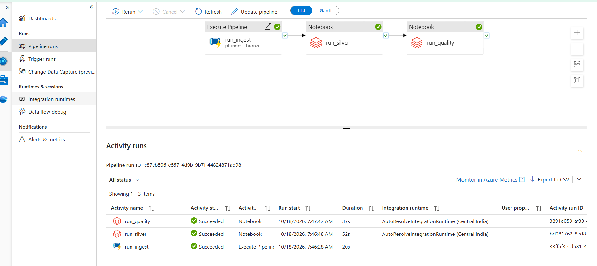

---

## Table of Contents

1. [Executive Summary](#1-executive-summary)
2. [Architecture](#2-architecture)
3. [Technology Stack](#3-technology-stack)
4. [Repository Structure](#4-repository-structure)
5. [Implementation Walkthrough](#5-implementation-walkthrough)
6. [Data Model](#6-data-model)
7. [Data Quality and Reconciliation](#7-data-quality-and-reconciliation)
8. [Security and Governance](#8-security-and-governance)
9. [Cost Management](#9-cost-management)
10. [Results](#10-results)
11. [Challenges and Lessons Learned](#11-challenges-and-lessons-learned)
12. [Known Limitations](#12-known-limitations)
13. [Future Improvements Roadmap](#13-future-improvements-roadmap)
14. [How to Reproduce](#14-how-to-reproduce)
15. [Author](#15-author)

---

## 1. Executive Summary

Financial transaction data is sensitive, high-volume and must reconcile exactly. This project demonstrates how to build a platform that handles it responsibly:

| Concern | How it is addressed |
|---|---|
| **Reliability** | Idempotent Delta `MERGE` upserts; re-running a job never creates duplicates |
| **Privacy** | Customer identity replaced by salted SHA-256 hash; email, name and IBANs never reach Silver or Gold |
| **Trust in the numbers** | Automated quality gate plus Bronze = Silver = Gold reconciliation (count and sum) |
| **Automation** | One ADF master pipeline chains ingestion, transformation and validation |
| **Security** | No credentials in code or notebooks; secrets in Azure Key Vault, access via Azure RBAC |
| **Reproducibility** | Infrastructure defined as code (Bicep) |
| **Cost control** | Pausable warehouse, auto-terminating compute, Import-mode BI |

> **Data note:** all data is synthetic (generated with Python/Faker). No real customer or banking data is used.

**Scale of the demo:** 100,000 transactions, 5,000 customers, 3 currencies (EUR, USD, QAR), 16 days of activity, 4 Gold tables.

---

## 2. Architecture

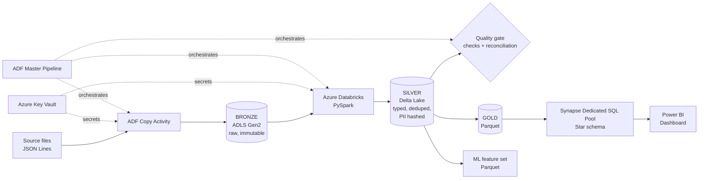

| Layer | Location | Purpose |
|---|---|---|
| **Bronze** | `bronze/raw_transactions/year=YYYY/month=MM/` | Raw files exactly as received, partitioned by date; the audit source of truth |
| **Silver** | `silver/transactions_delta` (Delta Lake) | Cleaned, typed, deduplicated, anonymized, categorized |
| **Gold** | `gold/` (Parquet) and Synapse `gold` schema | Business-ready star schema for reporting |
| **Features** | `gold/ml_features/customer_risk_v1/` | Per-customer behavioural features for ML |

All Azure resources live in one resource group in the **Central India** region.

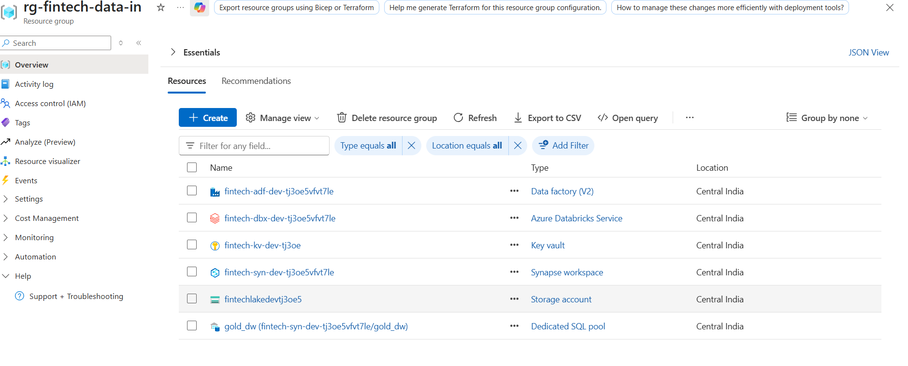

---

## 3. Technology Stack

| Area | Technology |
|---|---|
| Cloud platform | Microsoft Azure |
| Data lake | Azure Data Lake Storage Gen2 (hierarchical namespace) |
| Table format | Delta Lake, Parquet |
| Orchestration | Azure Data Factory |
| Distributed processing | Azure Databricks, PySpark |
| Data warehouse | Azure Synapse Analytics, Dedicated SQL Pool (T-SQL) |
| Business intelligence | Power BI Desktop, DAX |
| Secrets and identity | Azure Key Vault, Managed Identity, Azure RBAC |
| Infrastructure as code | Bicep, Azure CLI |
| Languages | Python, SQL, PySpark |
| Version control | Git, GitHub |

---

## 4. Repository Structure

```
fintech-lakehouse/
├── infra/
│   └── main.bicep                  # Key Vault, Data Factory, Databricks, Synapse, RBAC
├── src/
│   ├── generate_transactions.py    # Synthetic data generator (100k records)
│   ├── silver_clean_pipeline.py    # Bronze -> Silver (clean, hash PII, Delta MERGE)
│   ├── gold_build.py               # Silver -> Gold dimensions and fact
│   ├── data_quality.py             # Quality checks and reconciliation gate
│   └── ml_features.py              # 30-day customer feature extraction
├── docs/
│   └── images/                     # Screenshots used in this README
└── README.md
```

---

## 5. Implementation Walkthrough

### 5.1 Infrastructure as Code
`infra/main.bicep` provisions Azure Key Vault (RBAC authorization), Azure Data Factory with a system-assigned managed identity, an Azure Databricks workspace and an Azure Synapse workspace with a Dedicated SQL Pool, plus the role assignment that lets Data Factory write to the lake. The storage account and its containers (`bronze`, `silver`, `gold`, `synapse-workspace`) were created with Azure CLI and are referenced from Bicep as an existing resource (see [Challenges](#11-challenges-and-lessons-learned)).

### 5.2 Bronze: raw ingestion
An ADF pipeline (`pl_ingest_bronze`) copies source files into Bronze using a **Binary** dataset, so files are copied byte-for-byte and stay immutable. The destination folder is computed from the trigger time, producing date-partitioned paths:

```
@concat('raw_transactions/year=', formatDateTime(pipeline().TriggerTime, 'yyyy'),
        '/month=', formatDateTime(pipeline().TriggerTime, 'MM'))
```

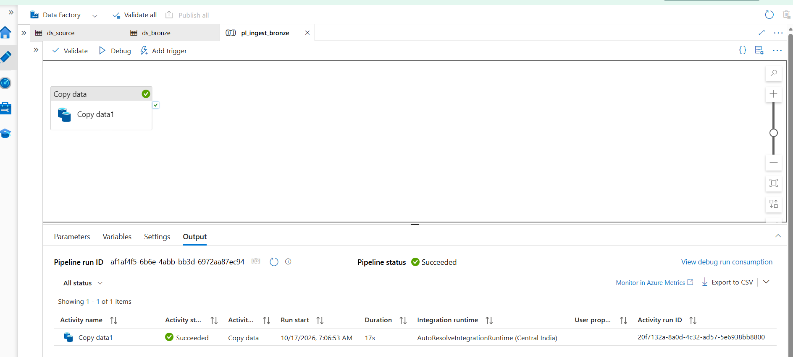

Result in the data lake (hierarchical namespace gives real directories):

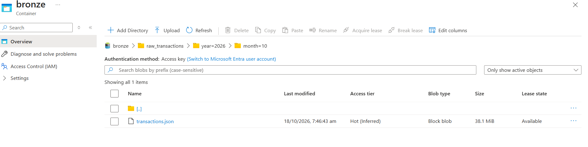

### 5.3 Silver: cleansing, anonymization, Delta upsert
`silver_clean_pipeline.py` reads Bronze with Spark and applies:

- Type casting (`amount` to `decimal(18,2)`, timestamps parsed)
- Deduplication on `transaction_id`
- Derived `direction` (INFLOW / OUTFLOW from the sign of the amount) and `category` (SALARY / TRANSFER / REVERSAL / GENERAL)
- **PII removal:** `customer_id_hashed = SHA-256(email + salt)`, then email, name and both IBANs are dropped
- An `ingested_at` audit column
- Idempotent **`MERGE INTO`** into a Delta table, followed by `OPTIMIZE ... ZORDER BY (transaction_date, category)`

**Before:** the Bronze schema contains customer email, name and IBANs.

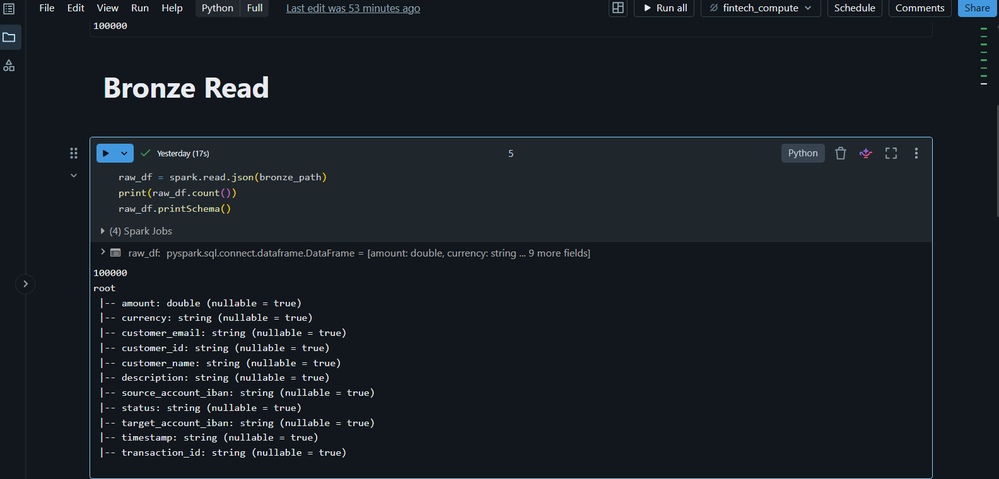

**After:** the Silver transformation, which hashes the identity and drops every PII column.

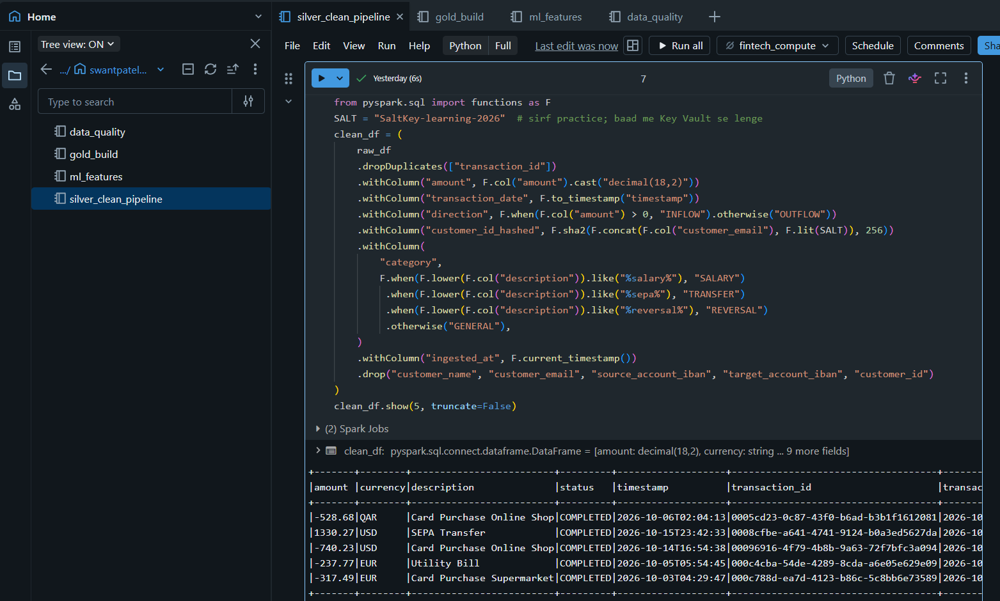

Re-running the merge keeps the row count at 100,000, which demonstrates idempotency.

### 5.4 Gold: star schema in Synapse
`gold_build.py` produces the dimensions and fact as Parquet, which are loaded into the Dedicated SQL Pool with `COPY INTO`. Table design follows MPP best practice: a large fact table is hash-distributed on its join key, small dimensions are replicated to every compute node, and all tables use clustered columnstore indexes.

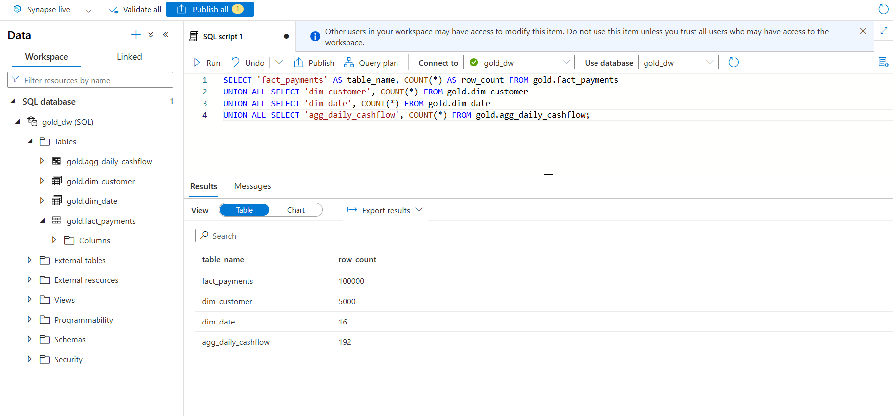

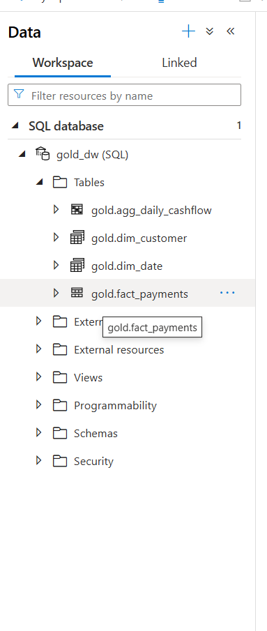

### 5.5 Orchestration
`pl_master` chains three activities with on-success dependencies. If any step fails, downstream steps do not run, so bad data cannot propagate.

```
run_ingest  ->  run_silver  ->  run_quality
```

Notebook activities authenticate to Databricks with an access token read from Key Vault. A full run completes in roughly two minutes on this dataset (ingest 20 s, silver 52 s, quality 37 s), as shown in the first screenshot of this document.

### 5.6 BI and ML
**Power BI** connects to the Synapse Gold schema in Import mode, with one-to-many relationships from the date and customer dimensions to the fact table.

```
Total Inflow  = CALCULATE(SUM(fact_payments[amount]), fact_payments[direction] = "INFLOW")
Total Outflow = -CALCULATE(SUM(fact_payments[amount]), fact_payments[direction] = "OUTFLOW")
Net Position  = [Total Inflow] - [Total Outflow]
```

Outflow amounts are stored as negative numbers, so `Total Outflow` is negated to display a positive figure and keep `Net Position` correct. The dashboard is filtered to a single currency (EUR) because amounts in different currencies must not be summed.

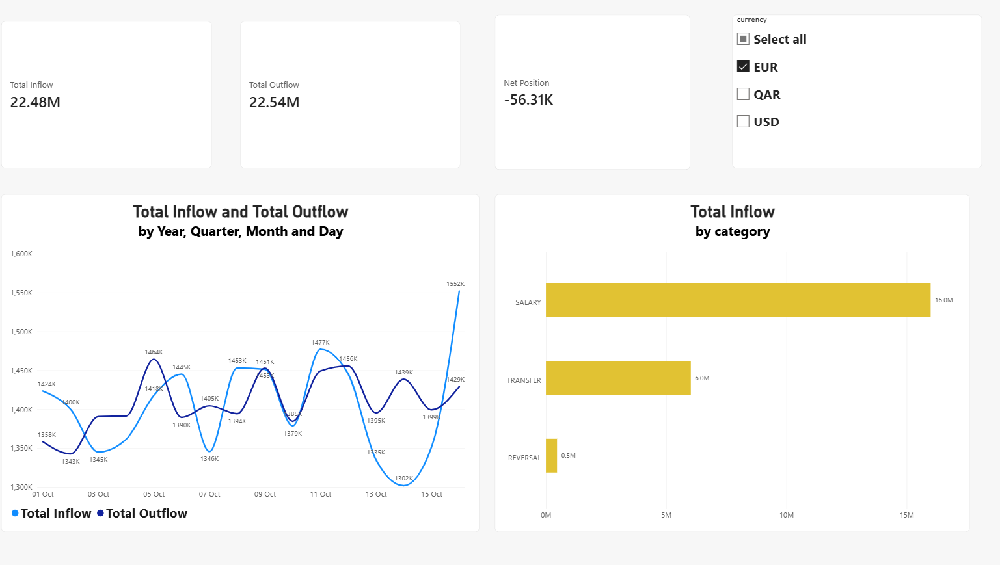

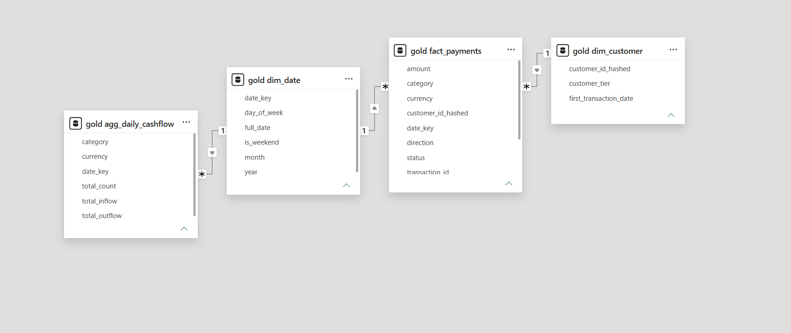

**ML features** (`ml_features.py`) are written per customer to Parquet: `avg_inflow_amount`, `inflow_frequency_days`, `salary_indicator_flag`, `stddev_transaction_amount`, `txn_count_30d`.

---

## 6. Data Model

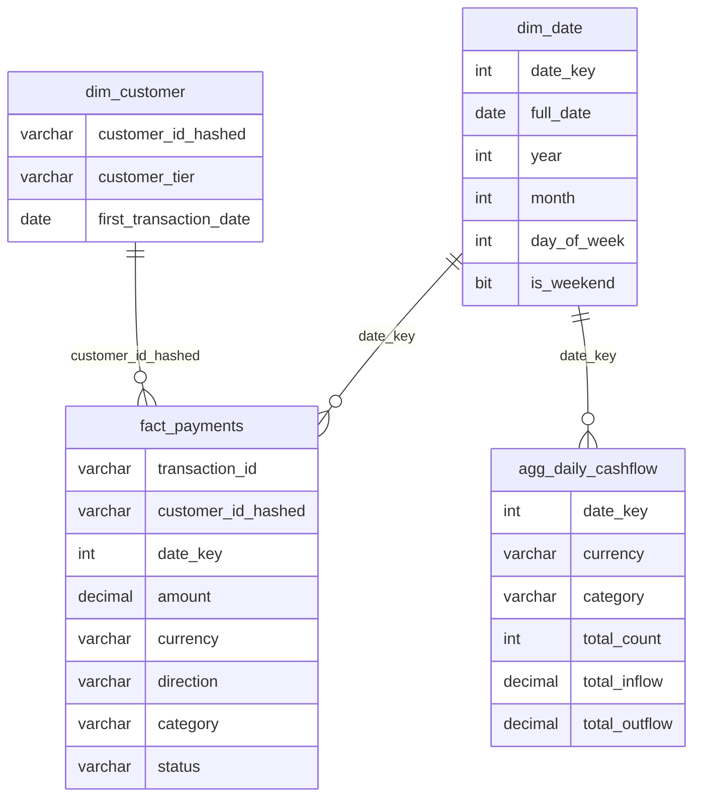

| Table | Distribution | Index | Reason |
|---|---|---|---|
| `fact_payments` | HASH(`customer_id_hashed`) | Clustered columnstore | High-cardinality key co-locates customer rows and reduces data movement in joins |
| `dim_customer` | REPLICATE | Clustered columnstore | Small table copied to all nodes, joins need no shuffle |
| `dim_date` | REPLICATE | Clustered columnstore | Same as above |
| `agg_daily_cashflow` | ROUND_ROBIN | Clustered columnstore | Pre-aggregated serving table for frequent dashboard queries |

---

## 7. Data Quality and Reconciliation

`data_quality.py` runs as a pipeline step and **raises an exception on any failure**, which stops the master pipeline.

**Rule checks (all passing):**
- `transaction_id` is not null and is unique
- `amount` is not null and not zero
- `currency` is one of EUR, USD, QAR
- `status` is one of COMPLETED, PENDING, FAILED
- PII columns are absent from Silver
- `direction` is consistent with the sign of `amount`

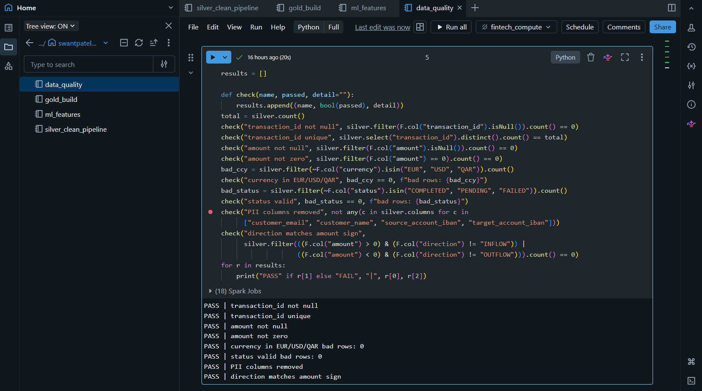

**Reconciliation:** the same record count and monetary total must appear in Bronze, Silver and Gold.

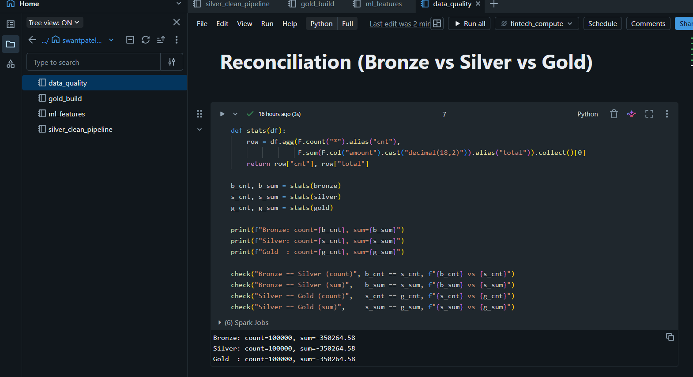

| Layer | Records | Total amount |
|---|---|---|
| Bronze | 100,000 | -350,264.58 |
| Silver | 100,000 | -350,264.58 |
| Gold | 100,000 | -350,264.58 |

Zero variance across all three layers.

---

## 8. Security and Governance

- **Secrets management:** the storage key and the Databricks token live in Azure Key Vault. Databricks reads them through a Key Vault-backed **secret scope**; Data Factory reads the token through a Key Vault linked service. No secret appears in notebooks or in this repository.
- **Least-privilege access:** Azure RBAC role assignments (Key Vault Secrets User, Storage Blob Data Contributor) rather than shared credentials.
- **Privacy by design:** raw PII exists only in the immutable Bronze layer. Everything downstream is pseudonymized.
- **Repository hygiene:** `.gitignore` excludes parameter files, local data and Power BI files; the repo was scanned for key material before publishing.
- **Immutable raw zone:** Bronze is never modified, so any downstream layer can be rebuilt from it.

---

## 9. Cost Management

Cloud data platforms can become expensive if left running. This project applies deliberate controls:

- The Synapse Dedicated SQL Pool is **paused** whenever it is not in use.
- Databricks compute **auto-terminates** after inactivity and is stopped after each session.
- Power BI uses **Import mode**, so dashboards do not require the warehouse to be online.
- A single resource group allows the whole environment to be removed with one command.

---

## 10. Results

| Metric | Value |
|---|---|
| Records processed | 100,000 |
| Customers | 5,000 |
| Gold tables | 4 (`fact_payments`, `dim_customer`, `dim_date`, `agg_daily_cashflow`) |
| Quality checks passing | 8 rule checks and 4 reconciliation checks |
| Reconciliation variance | 0 |
| End-to-end orchestrated run | About 2 minutes, all activities succeeded |
| PII columns in Silver and Gold | 0 |

---

## 11. Challenges and Lessons Learned

| Challenge | Resolution | Takeaway |
|---|---|---|
| `COPY INTO` failed with a type cast error | Synapse maps Parquet columns **by position**, not by name; columns were reordered to match the table definition | Always align column order explicitly when loading Parquet into a warehouse |
| Synapse deployment blocked by a workspace limit and a region restriction | Chose a supported region and worked within subscription quotas | Check service quotas early in a new subscription |
| Bicep preflight rejected the HNS storage account in this subscription | Created the storage account with Azure CLI and referenced it as `existing` in Bicep | Keep IaC pragmatic: fall back to CLI for a blocked resource and document it |
| Databricks could not read Key Vault secrets (HTTP 403) | Granted the Databricks service principal the Key Vault Secrets User role | With RBAC-mode vaults, every consumer needs an explicit role |
| Net position was inflated in the first BI draft | Outflow is stored as negative; the DAX measure was negated | Define and document sign conventions for financial measures |
| Mixed-currency totals in the dashboard | Dashboard restricted to one currency via slicer | Never aggregate across currencies without conversion |

---

## 12. Known Limitations

Stated openly so the scope is clear:

- **Short history:** 16 days of data, so the 30-day feature window and salary detection are illustrative. Real recurring-salary detection needs several months of history.
- **Gold load is not yet orchestrated:** loading Synapse from Gold Parquet is run manually and is not part of `pl_master`.
- **Quality checks use plain PySpark assertions** rather than a dedicated framework.
- **Storage access uses an account key** (held in Key Vault). Managed identity would be stronger.
- **Hash salt in the Silver notebook is a practice value.** Production should read it from Key Vault.
- **Batch only:** no streaming or incremental watermarking yet.
- **No CI/CD, monitoring alerts or lineage tool** yet.

---

## 13. Future Improvements Roadmap

Each item below explains **what** to build and **why it matters**. They are ordered by value versus effort.

### Priority 1: Close the gaps in the current design

| Improvement | What to do | Why it matters |
|---|---|---|
| **Orchestrate the Gold load** | Add an ADF step that resumes the SQL pool, runs `COPY INTO` through a stored procedure, then pauses the pool | Makes the pipeline truly end-to-end and removes manual steps |
| **Salt from Key Vault** | Read the hashing salt from the Databricks secret scope instead of the notebook | Removes the last hardcoded sensitive value; the salt can be rotated safely |
| **Managed identity for storage** | Replace the account key with Databricks access via managed identity or Unity Catalog external locations, and use managed identity in `COPY INTO` | Eliminates long-lived keys, which are a standard audit finding |
| **Monitoring and alerting** | Send ADF and Databricks logs to Log Analytics, create Azure Monitor alerts on pipeline failure and on quality failure, build a KQL dashboard | A pipeline that fails silently is a production risk; alerts cut detection time to minutes |
| **Scheduled and event-driven triggers** | Add a schedule trigger or a storage-event trigger so the pipeline runs without a person | Real platforms run unattended |

### Priority 2: Engineering maturity

| Improvement | What to do | Why it matters |
|---|---|---|
| **CI/CD with GitHub Actions** | On pull request run `bicep build` and `what-if`; on merge deploy infrastructure, publish ADF and sync notebooks | Repeatable, reviewed, auditable deployments |
| **Incremental processing** | Track a watermark or use Databricks Auto Loader to process only new files; keep the idempotent `MERGE` | Processing time stays flat as data grows instead of re-reading everything |
| **Quarantine for bad records** | Route rows that fail validation to a quarantine table instead of failing the whole run, with a reason code | Keeps good data flowing while preserving bad data for investigation |
| **Great Expectations or Delta Live Tables expectations** | Replace hand-written checks with a declarative framework and publish data docs | Standardised rules, readable reports, easier to extend |
| **Unit tests** | Test transformation functions with `pytest` on small DataFrames | Catches logic bugs before they reach production data |
| **Infrastructure as code for everything** | Resolve the storage-account issue so containers, role assignments and networking are fully in Bicep | One-command environment rebuild, no manual steps |

### Priority 3: Data modelling and analytics depth

| Improvement | What to do | Why it matters |
|---|---|---|
| **SCD Type 2 customer dimension** | Track history of tier changes with effective dates | Enables accurate "as it was then" reporting |
| **Merchant dimension** | Add `dim_merchant` and enrich transactions | Unlocks merchant-level analytics and fraud patterns |
| **Currency conversion** | Add an exchange-rate table and a reporting-currency measure | Allows a correct combined total across EUR, USD and QAR |
| **Larger, realistic history** | Generate 12+ months with realistic salary cycles | Makes the ML features and trends meaningful |
| **Performance tuning** | Table statistics, materialized views, partitioning on large facts, result-set caching | Keeps dashboards fast at larger volumes |
| **Power BI refinements** | Incremental refresh, row-level security by region or tier, DirectQuery or Direct Lake where freshness matters | Enterprise-grade BI governance |

### Priority 4: Platform evolution

| Improvement | What to do | Why it matters |
|---|---|---|
| **Streaming ingestion** | Event Hubs with Spark Structured Streaming into Bronze and Silver | Near-real-time payments monitoring and fraud alerts |
| **ML lifecycle** | Train a risk or salary-detection model in Azure Machine Learning from the feature set; track runs with MLflow; serve scores back to Gold | Turns the feature store into a working model |
| **Data governance** | Register assets in Microsoft Purview for lineage, classification and sensitive-data scanning; adopt Unity Catalog for access control | End-to-end lineage and compliance evidence |
| **Microsoft Fabric version** | Rebuild Bronze, Silver and Gold on OneLake with Lakehouse and Warehouse | Fabric is Microsoft's strategic direction for analytics, and a unified platform reduces operational overhead |
| **Serverless or smaller warehouse** | Evaluate Synapse serverless or Fabric Warehouse for low-volume workloads | Pay-per-query can be cheaper than an always-provisioned pool |
| **Data contracts** | Formal schema contracts with producers and automated contract tests | Prevents upstream schema changes from breaking the pipeline |

---

## 14. How to Reproduce

**Prerequisites:** an Azure subscription, Azure CLI, Python 3.10+, Git, Power BI Desktop (optional).

```bash
# 1. Sign in and create a resource group
az login
az group create --name rg-fintech-data-in --location centralindia

# 2. Create the data lake (hierarchical namespace) and containers
az storage account create --name <storage-name> --resource-group rg-fintech-data-in \
  --location centralindia --sku Standard_LRS --kind StorageV2 \
  --enable-hierarchical-namespace true
az storage container create --account-name <storage-name> --name bronze --auth-mode key
az storage container create --account-name <storage-name> --name silver --auth-mode key
az storage container create --account-name <storage-name> --name gold   --auth-mode key
az storage container create --account-name <storage-name> --name synapse-workspace --auth-mode key

# 3. Deploy the remaining infrastructure (set your own SQL admin password)
az deployment group create --resource-group rg-fintech-data-in \
  --template-file infra/main.bicep \
  --parameters environment=dev appPrefix=fintech synapseSqlAdminPassword='<your-password>'

# 4. Generate synthetic data
pip install faker
python src/generate_transactions.py
```

Then:

1. Upload the generated file to the source container and run `pl_ingest_bronze` in Data Factory.
2. Store the storage key and Databricks token in Key Vault and create the Databricks secret scope.
3. Run the notebooks in `src/` in this order: `silver_clean_pipeline`, `gold_build`, `data_quality`, `ml_features`.
4. Create the Gold tables in the SQL pool and load them with `COPY INTO`.
5. Connect Power BI to the Gold schema.

> Replace every `<placeholder>` with your own value. Never commit passwords, keys or tokens.

---

## 15. Author

**Your Name**
Data Engineer
[LinkedIn](https://www.linkedin.com/in/your-profile) · [GitHub](https://github.com/your-username) · your.email@example.com
